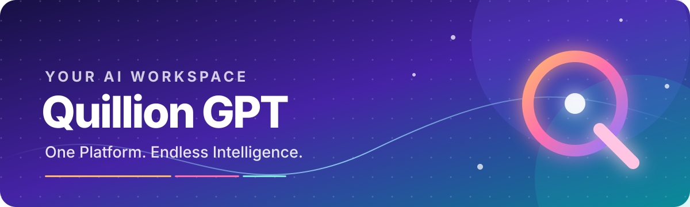

<!--
  Quillion GPT — GitHub project home
  Keep this README as the first impression of the project.
-->

<p align="center">
  
</p>

<p align="center">
  <strong>A colourful home for your everyday AI workspace.</strong><br/>
  Explore tools, chat with multiple AI providers, compare model responses, and save useful prompts.
</p>

<p align="center">
  
  
  
  
</p>

<p align="center">
  <a href="#-what-is-quillion-gpt">About</a> ·
  <a href="#-highlights">Highlights</a> ·
  <a href="#-supported-ai-providers">Providers</a> ·
  <a href="#-run-it-locally">Run locally</a> ·
  <a href="docs/DEPLOYMENT.md">Deployment guide</a>
</p>

---

## ✨ What is Quillion GPT?

**Quillion GPT** brings useful AI experiences together in one clean workspace. Instead of jumping between different websites, explore a collection of productivity tools, chat with connected AI models, compare their answers, and keep handy prompts close by.

> **One Platform. Endless Intelligence.**

## 🌈 Highlights

| Experience | What it does |
|:--|:--|
| 🧰 **Explore AI tools** | Browse writing, study, research, and productivity tools. |
| 💬 **AI Chat** | Chat with a model from a provider configured on the server. |
| ⚖️ **Quillion Compare** | Send one prompt to multiple connected models and view responses side by side. |
| 🧠 **AI Models** | View the providers and models configured for this deployment. |
| 📚 **Prompt Library** | Browse reusable prompts and save favourites. |
| ⭐ **Your workspace** | Keep favourite tools and saved prompts in this browser. |
| 🎨 **Personalise** | Switch the interface theme and make the workspace feel yours. |

## 🤖 Supported AI providers

Connect one or more providers by adding their credentials as server-side environment variables.

<p>
  
  
  
  
  
</p>

The available models depend on the model names and API access enabled in your provider accounts.

## 🚀 Run it locally

**Requirements:** Node.js 20+ and a Vercel account/CLI for the API routes.

1. Clone this repository:
   ```bash
   git clone https://github.com/yoyo-0909/QuillionGpt-.git
   cd QuillionGpt-
   ```
2. Install the Vercel CLI:
   ```bash
   npm install --global vercel
   ```
3. Copy `.env.example` to `.env` and add the provider keys and model names you want to use.
4. Start the local Vercel development server:
   ```bash
   vercel dev
   ```
5. Open the local URL printed by the CLI.

See **[the deployment guide](docs/DEPLOYMENT.md)** for Vercel setup and environment-variable details.

## 🔐 Security first

- **Never commit API keys.** Keep real credentials in a local `.env` file or Vercel Environment Variables.
- The current prototype does **not** include user sign-in or cloud accounts.
- Its in-memory request limiter is best-effort and is not a substitute for production rate limiting.
- A public deployment can let visitors use your configured provider credentials indirectly and consume your API credits. Set provider-side spending limits and add authentication before sharing widely.
- Do not use production credentials in a public demo.

## 🗺️ Project status

Quillion GPT is an evolving early-stage project. The current codebase provides the interface and server routes for configured AI providers. Authentication, persistent cloud accounts, billing, and production-grade abuse protection are not included in this prototype.

## 💜 Built with

- HTML, CSS, and JavaScript
- Node.js serverless API routes
- Multiple AI provider APIs
- Vercel deployment

---

<p align="center">
  <strong>Quillion GPT</strong><br/>
  <sub>Created by Yogesh Aravind Kumar · Made by Nova Tech Solutions</sub><br/><br/>
  <em>Built to make useful AI feel a little more accessible, every day.</em>
</p>
